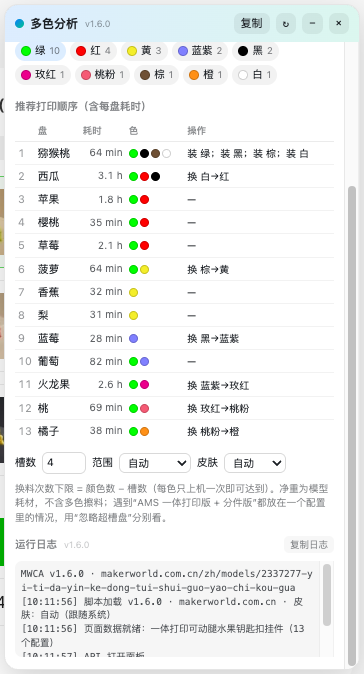
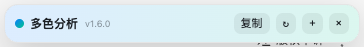
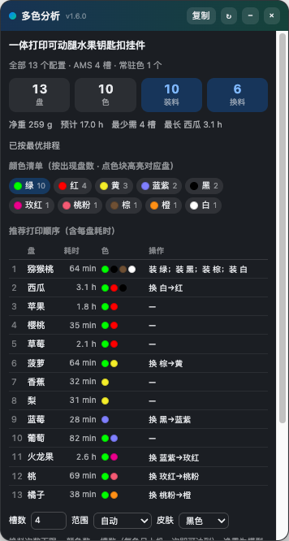
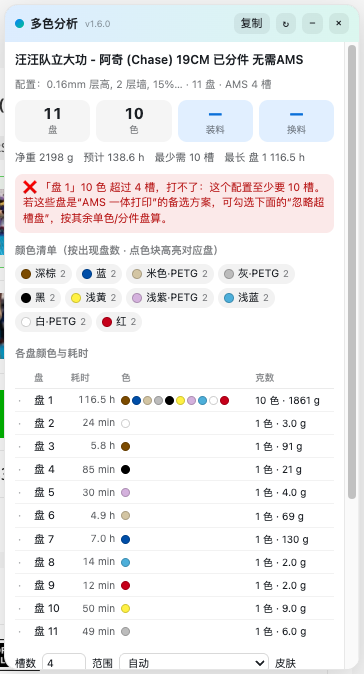

# MakerWorld 多色换料分析（AMS 排程器）

一个 Tampermonkey / 油猴用户脚本：打开 MakerWorld 模型页时，右下角会出现一个会轻微闪烁的「多色分析」按钮——**点它才分析**，不会一进页面就自动跑。点击后读取页面自带的打印配置数据，统计**所有打印盘**的耗材颜色，算出**最少装料 / 换料次数**，并给出推荐打印顺序和每盘耗时；点颜色块还能高亮用到该颜色的盘。

专为「多色打印时 AMS 料位不够、老要拔插耗材」这个痛点做的：比如 13 盘模型用了 10 种颜色，4 槽 AMS 最少要装 10 次、换 6 次——脚本会直接把这个结论和具体换料顺序列出来。


点开后的面板：



## 功能

- **按需触发**：右上角悬浮按钮（首次进入会闪烁提示），不点不分析；点开后才出面板，关闭后回到按钮
- **折叠 / 展开**：面板标题栏 `−`/`+` 按钮，折叠后只留一条标题栏；`×` 是彻底关掉回到按钮
- **运行日志 + 版本号**：标题栏和日志区都显示版本（当前 v1.5.0），日志记录加载、打开/关闭、分析结果和错误，可一键复制，排障用
- **快捷键兜底**：`Ctrl/Cmd + Alt + M` 切换面板，万一按钮被页面元素挡住也能用
- **皮肤 / 配色**：可选 `自动`（跟随系统）/ `同页面` / `反页面` / `白色` / `黑色`，暗色页面自动反色，设置会记住
- **点色高亮盘**：点颜色清单里的任意色块，表格里所有用到该颜色的盘高亮、其它盘变暗，并列出这盘名；再点一次取消
- **颜色清单**：每个颜色的中文名、HEX、出现盘数、总克数；自动区分 PLA / PETG，同名不同色会加 HEX 后缀区分
- **换料计算**：装料次数、换料次数、最少需要几个料位；不满足时直接提示“几槽打不了”
- **推荐打印顺序**：把共用颜色多的盘聚在一起、同材料分组，每一行写明开打前怎么换料（如 `换 白→红`）
- **每盘耗时**：按打印顺序列出每盘耗时、累计耗时（悬停）、最长盘
- **超槽盘处理**：遇到“AMS 一体版 + 分件版”塞在同一个打印配置里的模型，可勾选“忽略超槽盘”按分件/单色版重算
- **范围切换**：自动 / 全部配置 / 单个配置；一套多模型的合集（如 13 个水果）会自动全量统计
- **其他**：深浅色主题、面板可拖动/收起、一键复制 TSV（可贴 Excel 做排产表）

折叠后只留标题栏：



浅色页面上选「黑色」皮肤：





## 安装

1. 安装 [Tampermonkey](https://www.tampermonkey.net/)（Chrome / Edge / Firefox 均可）
2. 打开脚本安装地址，Tampermonkey 会弹出安装页：

   ```
   https://raw.githubusercontent.com/yueyao/makerworld-ams-planner/main/makerworld-ams-planner.user.js
   ```

   （也可以下载仓库里的 `makerworld-ams-planner.user.js` 拖进浏览器窗口安装）
3. 打开任意 MakerWorld 模型页，右下角出现「多色分析」面板

## 使用

| 控件 | 说明 |
|---|---|
| 悬浮按钮 | 页面右上角「多色分析」（可拖动、位置会记住），点开才分析；面板右上角 × 关闭后回到按钮 |
| 标题栏 − / + | 折叠或展开面板（折叠后只留标题栏，不收回成按钮） |
| 运行日志 | 面板最底部，显示版本和关键事件，可「复制日志」反馈问题 |
| 皮肤 | 自动 / 同页面 / 反页面 / 白色 / 黑色；「反页面」在浅色页面上会变成黑色，深色页面上变白色 |
| 颜色块 | 点击高亮用到该颜色的盘（其它盘变暗），再点取消 |
| 槽数 | 你的 AMS 料位数，默认 4（一台 AMS 2 Pro），多台改成 8 / 12 / 16 |
| 范围 | 自动 / 全部配置 / 单个打印配置 |
| 忽略超槽盘 | 某盘颜色数超过槽数时勾选，按剩下的盘算（适合“分件版”打法） |
| 复制 | 导出 TSV：顺序 / 模型 / 耗时 / 克数 / 颜色 / 操作 |
| − | 收起面板，不影响页面 |

## 作为 DSH Skill 使用

`skill/makerworld-ams-planner/` 是同一能力的 **DSH Skill 包**（`SKILL.md` + `scripts/mw_analyze.py` + 内置用户脚本）：

1. 把 `skill/makerworld-ams-planner/` 整个目录复制到 DSH 的 skill 目录：
   - 项目级：`<项目根>/.dsh/skills/makerworld-ams-planner/`
   - 用户级：`$DSH_HOME/skills/makerworld-ams-planner/`
2. 新会话里直接说「帮我分析这个 MakerWorld 模型链接」，Agent 会加载 skill 并跑脚本。
3. 也可以手动运行：

   ```bash
   python3 skill/makerworld-ams-planner/scripts/mw_analyze.py "<模型URL>" --slots 4
   # 可选：--ignore-over 排除超槽盘；--json 输出结构化数据
   ```

脚本依赖：Python 3 + Playwright（`pip install playwright && playwright install chromium`）+ 本机 Chrome；用有头模式过 Cloudflare。

## 算法

1. **装料下限** = 颜色种类数（每种颜色至少上机一次）
2. **换料下限** = `max(0, 颜色数 − 槽数)`（槽位满了必须腾位子）
3. **能否达到下限**：只要存在一种打印顺序，使任何切点上“同时在机的颜色数 ≤ 槽数”，就能每色只上一次机
4. 盘数 ≤ 16 时用**子集 DP** 精确求解（等价于求路径宽度）；超过 16 盘自动降级为启发式
5. 在最优解基础上再做局部搜索：共用颜色多的盘排在一起、同材料相邻，减少换色和改温度

例：13 盘 / 10 色 / AMS 4 槽 → 装料 10 次、换料 6 次（`10 − 4 = 6`），脚本会给出完整顺序。

## 兼容性与说明

- 站点：`makerworld.com.cn` / `makerworld.com`
- 数据源：页面 `<script id="__NEXT_DATA__">` 里的 `props.pageProps.design`，站内跳转后回退到页面自身的 `/api/v1/design-service/design/<id>` 接口
- **不额外请求第三方、不读取/上传账号凭据**；只读页面已有数据
- 耗时/克数来自作者打印配置里的预测值，不是本机切片结果；净重不含多色擦料（实际备料建议 ×1.3~1.5）
- 颜色中文名是按 HEX 推的近似名，对色请以 HEX 为准
- MakerWorld 大改版导致数据结构变化时，面板会静默不显示，不影响页面本身

## 排错

- 面板底部有**运行日志**，第一行就是版本号；点「复制日志」可导出。
- 或按 `F12` 打开 Console，搜 `[MWCA`，能看到同样的日志（`[MWCA v1.5.0] ...`）。
- 也可在 Console 里执行 `__MWCA__.logText()` 或 `__MWCA__.open()`。
- 如果点了按钮**没有任何日志**：脚本没运行（被禁用/装了两份旧的/未刷新页面）。
- 如果日志里是 `按下按钮 @x,y，命中 div#xxx` 且 `#xxx` 不是 `mwca-host`：按钮被页面元素挡住了，把日志发出来即可定位。

## 更新

脚本头带 `@updateURL` / `@downloadURL`，Tampermonkey 会自动检查更新；也可以直接重新安装上面的 raw 地址。

## License

MIT © 2026 Bo He
